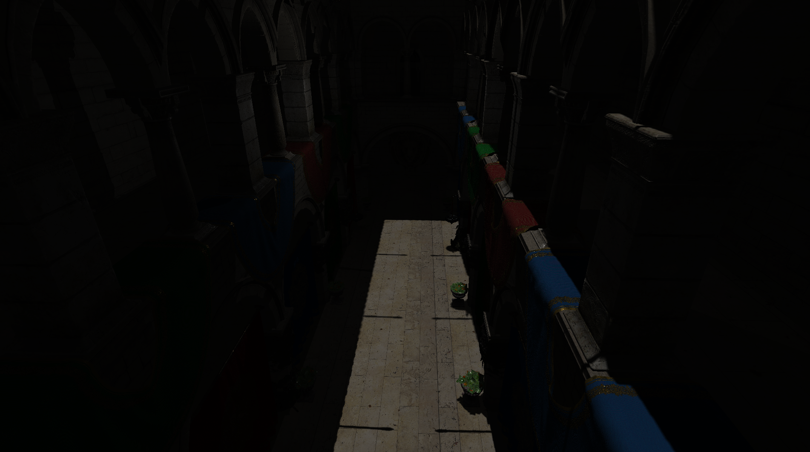

# KARYON ENGINE

A small, data-oriented C++23 game engine built from scratch on top of **bgfx** and **SDL3**.

> ⚠️ **Work in progress.** KARYON is an active personal project. APIs change often, some systems are temporary, and things will break.



---

## Features

### Core
- **Fixed-timestep game loop** – separate `Update` / `FixedUpdate`, max frame-time clamp, and a sleep-error-compensating frame limiter
- **Engine context** – a single `EngineCtx` hands systems access to the window, input, events, scenes, renderer and transforms
- **Transform hierarchy** – parent/child transforms stored as an intrusive sibling list, with cached world-space data

### ECS
- **Sparse-set component storage** – packed, cache-friendly component arrays with O(1) add/get/remove (swap-and-pop)
- **Registry** – `Create`, `Destroy`, `Add`, `Emplace`, `Push`, `Get`, `Has`, `Remove`
- **Views** – iterate a single component type or multiple at once: `reg.View<Transform, Camera>()`
- **Systems** – user-defined `System` classes with `OnLoad`, `Update`, `FixedUpdate`, `OnUnload` hooks and an explicit execution order

### Input
- **Action-based bindings** – bind keys, mouse buttons, mouse delta and gamepad input to typed actions (`bool`, `glm::vec2`, `glm::vec3`)
- **Composites** – `Composite2D` / `Composite3D` turn keys into axis vectors (WASD + up/down)
- **Triggers** – `OnKeyDown`, `OnKeyHeld`, `OnKeyUp` and mouse-button equivalents
- **Post-processors** – `Deadzone`, `ClampMagnitude`, plus configurable emit conditions

### Events
- Typed, per-frame event queues (`Push`, `Emplace`, `View`), flushed automatically at the end of each frame

### Scenes & Serialization
- **XML scenes** – entities, components and resources described in data files
- **Reflection-lite component registration** – components self-register with their XML name and fields, so new components are serializable with a few lines of code
- **glTF 2.0 loading** via fastgltf

### Renderer
- **bgfx backend** – runs on D3D11, D3D12, Vulkan, OpenGL, OpenGL ES or Metal (picked automatically per platform)
- **PBR shading** – Cook-Torrance BRDF (GGX / Smith / Schlick) with albedo, normal, metallic-roughness and emissive maps
- **Lights** – one directional light + up to 4 point lights
- **Shadows**
  - Cascaded shadow maps (4 cascades) with PCF for the directional light
  - Omnidirectional cube shadow maps for point lights
- **Shaders compiled at build time** for every backend the platform supports

---

## Tech Stack

| Library | Purpose |
|---|---|
| [bgfx](https://github.com/bkaradzic/bgfx) (bgfx.cmake) | Cross-API rendering, shader compiler |
| [SDL3](https://github.com/libsdl-org/SDL) | Windowing, input |
| [GLM](https://github.com/g-truc/glm) | Math |
| [fastgltf](https://github.com/spnda/fastgltf) | glTF model loading |
| [tinyxml2](https://github.com/leethomason/tinyxml2) | Scene file parsing |

All dependencies are fetched automatically through CMake `FetchContent` — nothing needs to be installed manually.

---

## Building

### Requirements
- CMake **3.26+**
- A C++23 compiler (developed with **MSVC / Visual Studio 2022**; other compilers/platforms are currently untested)
- Git (for fetching dependencies)

### Build

```bash
git clone https://github.com/butterdawgg/KARYON_ENGINE.git
cd KARYON_ENGINE

cmake --preset debug       # or: release
cmake --build --preset debug
```

The first configure takes a while, since bgfx and SDL3 are downloaded and built from source.

After building, the `data/` folder and the SDL3 shared library are copied next to the executable automatically. Run `KARYON_ENGINE` from the build output directory.

Visual Studio users can also just open the folder — the CMake presets are picked up automatically.

### Controls (demo scene)
| Input | Action |
|---|---|
| `W A S D` | Move |
| `Space` / `Left Ctrl` | Up / down |
| Hold `Right Mouse` + move mouse | Look around |

---

## Usage

### Engine entry point

```cpp
#include "karyon.h"

static void load(const krn::EngineCtx& ctx)
{
    auto move = ctx.input.Bind<glm::vec3>(krn::Composite3D {
        krn::Key::W, krn::Key::S, krn::Key::A, krn::Key::D,
        krn::Key::Space, krn::Key::LeftCtrl }, "move");

    ctx.systems.AddSystem(std::make_unique<MySystem>(move), 10);
    ctx.scenes.LoadScene("scene0.xml");
}

int main()
{
    krn::EngineSettings engineSettings { .loadCallback = load };
    krn::WindowSettings windowSettings { };
    krn::Engine karyon { engineSettings, windowSettings };

    karyon.Run();
}
```

### Writing a system

```cpp
class Spinner final : public krn::System
{
public:
    void Update(const krn::EngineCtx& ctx, krn::Registry& reg, float dt) override
    {
        for (auto& [transform, spin] : reg.View<krn::Transform, Spin>())
        {
            // ...
        }
    }
};
```

### Defining a serializable component

```cpp
struct PointLight : public krn::Registrar<PointLight>
{
    static void Register()
    {
        krn::SerializeManager::RegisterComponent<PointLight>("point_light")
            .Parameter("color", &PointLight::color)
            .Parameter("intensity", &PointLight::intensity)
            .Parameter("range", &PointLight::range);
    }

    glm::vec3 color { 1.0f };
    float intensity { 1.0f };
    float range { 10.0f };
};
```

### Scene file

```xml
<scene>
    <resources>
        data/models/sponza/Sponza.gltf
    </resources>

    <entities>
        <entity gltf_file_id="0"></entity>

        <entity>
            <camera></camera>
            <transform>
                <position>0, 10, 0</position>
            </transform>
        </entity>

        <entity>
            <point_light>
                <intensity>4</intensity>
                <range>15</range>
            </point_light>
            <transform>
                <position>0, 5, 0</position>
            </transform>
        </entity>
    </entities>
</scene>
```

---

## Project Structure

```
KARYON_ENGINE/
├── CMakeLists.txt          # root project
├── CMakePresets.json       # debug / release presets
└── project/
    ├── CMakeLists.txt      # dependencies, executable, shader compilation
    ├── data/
    │   ├── models/         # glTF assets (Sponza)
    │   ├── scenes/         # XML scene files
    │   └── shaders/src/    # bgfx .sc shaders (compiled to shaders/bin at build time)
    └── src/
        ├── core/           # engine loop, window, input, events, scenes, transforms
        ├── ecs/            # entity, sparse-set storage, registry, systems
        ├── renderer/       # bgfx renderer, PBR, lights, camera, shadow maps
        ├── serialization/  # component registration + XML parser
        ├── temp/           # temporary gameplay code (free-fly camera)
        ├── karyon.h        # single include for engine users
        └── main.cpp        # demo application
```

---

## Roadmap

<!-- TODO: adjust to your actual plans -->
- [x] Sparse-set ECS with multi-component views
- [x] Action-based input system
- [x] XML scene loading + component serialization
- [x] glTF loading
- [x] PBR shading
- [x] Cascaded + point-light shadow maps
- [ ] Separate the engine into its own library target (engine / game split)
- [ ] Image-based lighting
- [ ] Post-processing (tonemapping, bloom, …)
- [ ] Physics
- [ ] Audio
- [ ] Editor / debug UI
- [ ] Linux / macOS support verified

---

## Credits

- **Sponza** model from the [Khronos glTF Sample Assets](https://github.com/KhronosGroup/glTF-Sample-Assets) (original by Frank Meinl, Crytek)
- Libraries listed under [Tech Stack](#tech-stack)

## License

<!-- TODO: pick a license (e.g. MIT) and add a LICENSE file -->
No license yet — all rights reserved until one is added.
